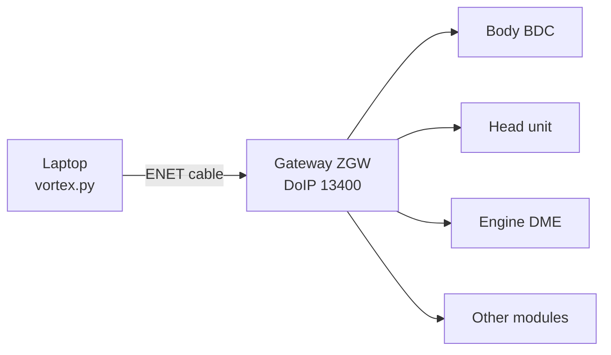

# Vortex Diagnostics Toolkit (BMW / MINI)

A command line tool that talks to BMW and MINI cars over ENET using **DoIP (ISO 13400) and UDS (ISO 14229)**. It reads vehicle identity, module versions, fault codes and battery voltage, and runs a safety check before any coding work. I built it to support my mobile BMW and MINI coding service.

It's **read only by design.** It only sends diagnostic read requests (UDS `0x22`, `0x19`), plus fault memory clear (`0x14`) after you confirm. It never codes, flashes or touches security access. Coding itself stays in E-Sys or BimmerCode. This tool makes sure the car is healthy and backed up first.

> **Status:** fully tested against a simulated BMW gateway (included). Live vehicle testing is in progress, and module addresses and data identifiers may need tuning per model.

---

## What it does

| Command | Purpose |
|---|---|
| `read [--scan]` | Finds the car, reads VIN, part numbers and software versions, and probes common modules (gateway, body, head unit, engine). Saves a JSON record. |
| `check` | **Safety check before coding:** battery voltage, firmware level and whether a backup is filed for this VIN. Says STOP if not. |
| `battery` | Battery voltage with OK / LOW / TOO LOW guidance before flashing. |
| `istep` | Software version identifiers to match E-Sys data. |
| `faults [--clear]` | Reads fault codes (DTCs). Clears them only after you type `y`. |
| `diff` | Snapshots a module before and after work and compares them. |
| `backup add / scan / list / find` | Files real E-Sys / BimmerCode backups by VIN, with a searchable index. |
| `invoice`, `export` | HTML job card, and prefill for the job and quote tool. |

## Example (simulated car)

```
$ python vortex.py read --ip 127.0.0.1 --scan
[+] Car at 127.0.0.1 (gw 0x10)
    VIN: WBASIM00000000001
    HW part no: SIM-ZGW-0001
    SW version: ZGW_SIM_22.07
    System name: ZGW
[*] Probing common modules...
    [10] Gateway/ZGW: ZGW_SIM_22.07
    [40] Body (BDC/FEM): BDC_SIM_21.11
    [60] Head unit: ID5_SIM_20.11
    [12] DME engine: responded
[+] Saved -> vortex_read_WBASIM00000000001.json

$ python vortex.py check --ip 127.0.0.1
[+] Car at 127.0.0.1
    VIN: WBASIM00000000001
    Firmware/SW: ZGW_SIM_22.07
    Battery: 12.62 V OK
    Backup on file: NO - make + file one before coding

[gate] STOP: no backup filed for this VIN yet.

$ python vortex.py faults --ip 127.0.0.1
[+] 2 fault(s):
    801A20  status 08
    E1A421  status 2F
```
All values come from the simulator. The VIN is a dummy.

## How it works



1. **Discovery:** listens for the car's DoIP vehicle announcement on UDP 13400, or uses `--ip`.
2. **Routing activation:** opens a DoIP session with the gateway (logical address `0x10`).
3. **UDS requests:** reads identification data identifiers (`F190` VIN, `F191`/`F195` part and software numbers) from each module through the gateway, and fault codes with `0x19 02`.
4. **Handling real world responses:** modules that aren't fitted (DoIP negative acknowledge) are skipped after the first reject. Unsupported identifiers (UDS negative response `0x31`) and timeouts are skipped without stopping the scan.

## Simulated gateway and tests

Without a car on the bench, I wrote a **simulated BMW gateway** ([`sim/fake_gateway.py`](sim/fake_gateway.py)) that speaks real DoIP over TCP. It has several fake modules that behave like real ones:
- a gateway with VIN, battery voltage and stored fault codes
- body and head unit modules
- an engine module that refuses one identifier and never answers another (timeout)
- modules that aren't fitted, which reject requests at the DoIP level
- vehicle announcements, so auto discovery can be tested

[`tests/test_vortex.py`](tests/test_vortex.py) runs `vortex.py` as a real command line program against the simulator. **12 tests:**

| Area | What's checked |
|---|---|
| Reading | Module scan finds the fitted modules; unfitted ones are skipped after one reject; missing identifiers are handled; auto discovery works without `--ip` |
| Errors | No car connected gives a clear message, not a crash |
| Battery | OK, LOW and TOO LOW thresholds; missing voltage identifier |
| Faults | Read fault codes; clear **only** after typing `y` |
| Safety check | Blocks coding until a backup is filed for the VIN |
| Backups | Repeated backups never overwrite each other; VIN search ignores case |
| Diff | A changed module value shows up in the before and after comparison |
| Offline tools | Export and job card |

**What testing caught:** the first version failed 4 of these tests, and all 4 are now fixed:
1. Two backups of the same car in the same second went into one folder, so **the second overwrote the first.** Each backup now gets its own folder.
2. No car connected gave a Python crash instead of a clear message.
3. Every rejected request printed library error text, so about 60 lines of noise buried the results. Library logs are now hidden unless you use `--verbose`.
4. Modules that aren't fitted got every identifier request. The scan now moves on after the first reject.

## Run it

```bash
pip install -r requirements.txt

# try it with no car: start the simulator, then use the tool in a second terminal
python sim/fake_gateway.py --announce
python vortex.py read --scan
python vortex.py check --ip 127.0.0.1

# run the tests
python -m unittest discover -v tests
```

On a real car: ENET cable into the OBD port, ignition on (engine off), battery charger connected, laptop Ethernet on automatic IP (`169.254.x.x`). Add `--verbose` before the command to see protocol logs, for example `python vortex.py --verbose read`.

## Limitations

- Not yet validated on a live vehicle. Module addresses, the battery voltage identifier and response timing need confirming per model.
- Some BMW models may use BMW's own ENET protocol (HSFZ, TCP 6801) rather than standard DoIP. Adding HSFZ support is the next step if live testing shows it's needed.
- `diff` compares identification data, not the coding data itself, which stays in E-Sys.

## Built with

Python, [`doipclient`](https://github.com/jacobschaer/python-doipclient) and [`udsoncan`](https://github.com/pylessard/python-udsoncan). Built with Claude as an AI coding assistant.

*Aftermarket tool, not affiliated with BMW or MINI.*
